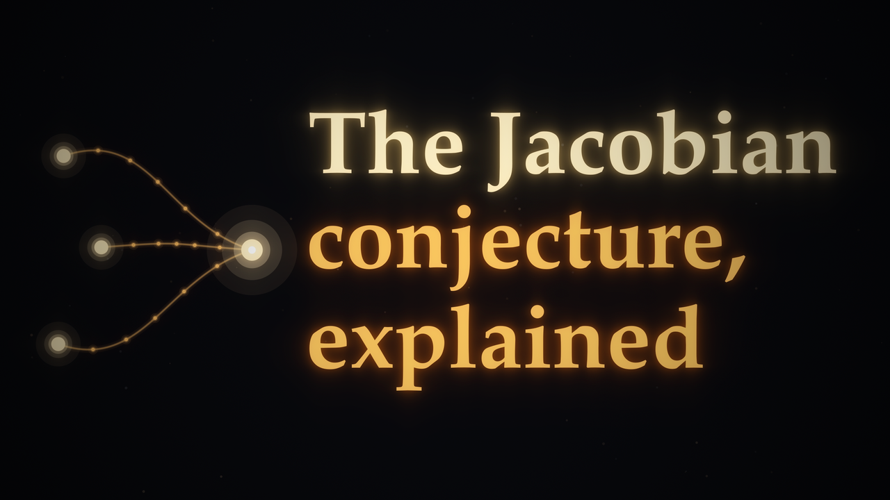
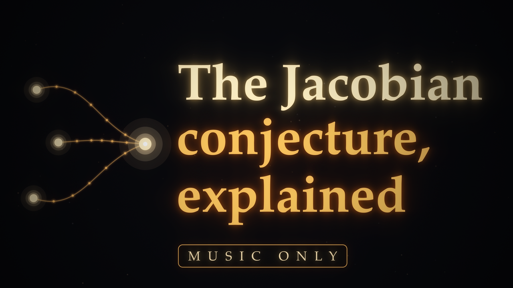

# Jacobian Conjecture Exposition

Locally Invertible, Globally Not: the 2026 counterexample to the Jacobian conjecture, and why the plane is still open

Author: Zinan Xing

Essay (PDF): [jacobian-conjecture-exposition.pdf](jacobian-conjecture-exposition.pdf)

A 10-page guide for readers who know calculus and linear algebra. It checks Levent Alpöge's July 2026 counterexample in dimension three by hand, explains why it works, and separates what is proved, what is formally checked and what is still open (dimension two, the case MathDB lists as JSP-000037). It also describes the author's Lean 4 refutation of MathDB's formal statement: [jacobian-conjecture-lean](https://github.com/neoskyz/jacobian-conjecture-lean). Prepared with the assistance of AI.

## Videos

**Narrated**

**Music only**

License: [CC BY 4.0](LICENSE)
